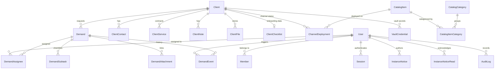

# Rateway Support System — Database Schema & Data Dictionary

This document details the PostgreSQL schema managed via Prisma ORM for the Rateway Support System. It covers all relational models, data integrity rules, cryptographic guarantees (Vault AES-256-GCM), and sequence generators.

---

## 1. Entity-Relationship Overview

---

## 2. Core Data Models

### 2.1 Clients & Onboarding (`clients`)

#### `Client`
Represents an accommodation property (hotel, pousada, boutique resort) managed by Rateway.
- `id` (`String` / `cuid`, PK): Internal unique surrogate key.
- `displayCode` (`String`, Unique): Monotonically increasing sequential display code (e.g., `"101"`).
- `name` (`String`): Commercial property name.
- `legalName` (`String?`): Official corporate/fiscal name (Razão Social).
- `cnpj` (`String?`): Masked Brazilian corporate tax identifier (`XX.XXX.XXX/XXXX-XX`).
- `status` (`String`, Default `"ativo"`): Lifecycle state (`"ativo"`, `"pausado"`, `"inativo"`).
- `logoUrl` (`String?`): Cloud storage URL or local asset path for property branding.
- `channelManagerId` (`String?`, FK): Catalog item reference for the contracted Channel Manager.
- `pmsId` (`String?`, FK): Catalog item reference for the Property Management System.
- `channelManagerOnline` (`Boolean`, Default `true`): Cloud-hosted vs. on-premise installation flag.
- `pmsOnline` (`Boolean`, Default `true`): Cloud-hosted vs. on-premise installation flag.
- `createdAt` / `updatedAt` (`DateTime`): Audit timestamps.

#### `ClientChecklist`
Stores the comprehensive 10-module operational onboarding specification for the client.
- `id` (`String` / `cuid`, PK): Primary key.
- `clientId` (`String`, Unique, FK): One-to-one relationship with `Client`.
- `progressPct` (`Int`, Default `0`): Computed completion percentage (0 to 100).
- `data` (`Json`): Serialized JSON storing field values for all 10 modules:
  - `razaoSocial`, `nomeFantasia`, `cnpj`, `inscricaoMunicipal`, `inscricaoEstadual`, `nire`, `cadastur`, `titularNome`, `titularCpf`, `anoInauguracao`, `anoReforma`.
  - `telefones` (array with number, label, and usability tags: `recepcao`, `seguranca_2fa`, `financeiro`, `emergencia`).
  - `emailReservas`, `emailFinanceiro`, `responsaveis`.
  - `canais` (channel selection states: `ja_possui`, `a_cadastrar`, `nao_contratado`), `pmsOnlineLocal`, `motorReservasUrl`.
  - `endereco`, `mapsUrl`, `horariosRecepcao`, `checkIn`, `checkOut`, `regimeAlimentacao`, `restaurante`, `estacionamento`, `wifi`, `areasComuns`.
  - `acomodacoes` (array of room categories: name, inventory, max guests, bed layouts, bathrooms, heating, accessibility, difs).
  - `comodidadesQuarto` (33 room amenities with 3-state value: `todas`, `algumas`, `nenhuma`).
  - `politicaCancelamento`, `politicaNoShow`, `politicaCriancas`, `politicaPets`, `regrasCasa`, `taxaTurismo`.
  - `dadosBancarios` (bank code, agency, account, digit, PIX key), `pagamentosBalcao`, `alinhamentoComercial`.
  - `aeroportoProximo`, `rodoviariaProxima`, `pontosInteresse`, `rotasAcesso`, `eventosLocais`.
  - `website`, `instagram`, `drivePastas`, `textosVenda`.
- `meta` (`Json`): Field-level metadata storing manual status overrides (`ok`, `pend`, `conf`, `na`) and private internal team notes.
- `updatedById` (`String?`): User ID of the last operator who modified the checklist.
- `updatedAt` (`DateTime`): Last modification timestamp.

---

### 2.2 Cadastros & Channel Deployments (`channel_deployments`)

#### `ChannelDeployment`
Tracks the individual onboarding and deployment status of each catalog sales channel per property.
- `id` (`String` / `cuid`, PK): Primary key.
- `clientId` (`String`, FK): Property reference.
- `catalogItemId` (`String`, FK): Sales channel reference from `CatalogItem`.
- `status` (`String`, Default `"nao_contratado"`):
  - `"nao_contratado"`: Channel out of scope or uncontracted.
  - `"a_cadastrar"`: Contracted, queued in onboarding pipeline.
  - `"em_andamento"`: Actively being configured by Rateway analysts.
  - `"feito_pelo_channel_manager"`: Configured directly via Channel Manager integration.
  - `"no_ar"`: Published live with rates and active ARI sync.
- `priority` (`String`, Default `"normal"`): Urgency flag (`"normal"`, `"alta"`, `"critica"`).
- `deadline` (`DateTime?`): Target go-live date.
- `bottleneck` (`String?`): Operational blocker (e.g., `"Aguardando documentação"`, `"Aguardando canal"`).
- `liveAt` (`DateTime?`): Timestamp when channel was marked `"no_ar"`.
- `notes` (`String?`): Freeform analyst notes.
- **Constraints**: `@@unique([clientId, catalogItemId])`.

---

### 2.3 Operational Demands (`demands`)

#### `Demand`
Operational tickets and tasks requested for or by clients.
- `id` (`String` / `cuid`, PK): Primary key.
- `displayCode` (`String`, Unique): Monotonically increasing identifier with prefix (e.g., `"D-0042"`).
- `title` (`String`): Ticket subject.
- `status` (`String`, Default `"triagem"`): Kanban state (`"triagem"`, `"em_andamento"`, `"aguardando_cliente"`, `"concluida"`, `"cancelada"`).
- `priority` (`String`, Default `"normal"`): Urgency level (`"normal"`, `"alta"`, `"critica"`).
- `clientId` (`String?`, FK): Associated property.
- `platformId` (`String?`, FK): Associated channel or PMS system.
- `dueDate` (`DateTime?`): Deadline date.
- `dueTime` (`String?`): Deadline time (`HH:mm`).
- `description` (`Json`): Rich-text document schema (Tiptap / ProseMirror).
- `requireAllConfirm` (`Boolean`, Default `false`): Requires collective sign-off from all assignees before completion.
- `completedAt` (`DateTime?`): Completion timestamp.
- `completedById` (`String?`, FK): User who concluded the demand.

#### `DemandAttachment`
Decoupled attachments for demands (supporting direct URLs and Google Drive links).
- `id` (`String` / `cuid`, PK): Primary key.
- `demandId` (`String`, FK): Associated demand.
- `name` (`String`): Display name.
- `url` (`String`): Direct web link or Google Drive / Docs URL.
- `mimeType` (`String?`): Detected MIME type.

---

### 2.4 Team Notices & Dashboard Broadcasts (`instance_notices`)

#### `InstanceNotice`
Administrative team broadcasts displayed on the Home Dashboard.
- `id` (`String` / `cuid`, PK): Primary key.
- `text` (`String`): Announcement text.
- `authorId` (`String`, FK): Administrator user reference.
- `authorName` (`String`): Snapshot of author display name.
- `expiresAt` (`DateTime?`): Automatic expiration timestamp.
- `createdAt` (`DateTime`): Publication timestamp.

#### `InstanceNoticeRead`
Per-user acknowledgment records ("Ciente").
- `noticeId` (`String`, FK): Notice reference.
- `userId` (`String`, FK): User reference.
- `readAt` (`DateTime`): Acknowledgment timestamp.
- **Constraints**: `@@id([noticeId, userId])`.

---

## 3. Security, Cryptography & Vault Specs (`vault_credentials`)

#### `VaultCredential`
Stores client extranet credentials (usernames and passwords) with military-grade encryption.
- `id` (`String` / `cuid`, PK): Primary key.
- `clientId` (`String`, FK): Associated client.
- `catalogItemId` (`String`, FK): Associated platform (OTA, PMS, Channel Manager).
- `username` (`String`): Login username or ID.
- `encryptedSecret` (`String`): Base64-encoded payload containing IV, ciphertext, and GCM auth tag.
- `notes` (`String?`): Internal notes.

### Cryptographic Implementation:
- **Algorithm**: `AES-256-GCM` (Galois/Counter Mode).
- **Key Derivation**: 256-bit key from `VAULT_MASTER_KEY` environment variable.
- **Initialization Vector (IV)**: 12-byte cryptographically secure random bytes generated per write (`crypto.randomBytes(12)`).
- **Authentication Tag**: 16-byte GCM authentication tag preventing any ciphertext tampering or bit-flipping attacks.
- **Export Policy**: When exporting client checklists to JSON, sensitive vault credentials are explicitly masked unless the operator specifically unchecks the `Ocultar dados sensíveis` toggle.
